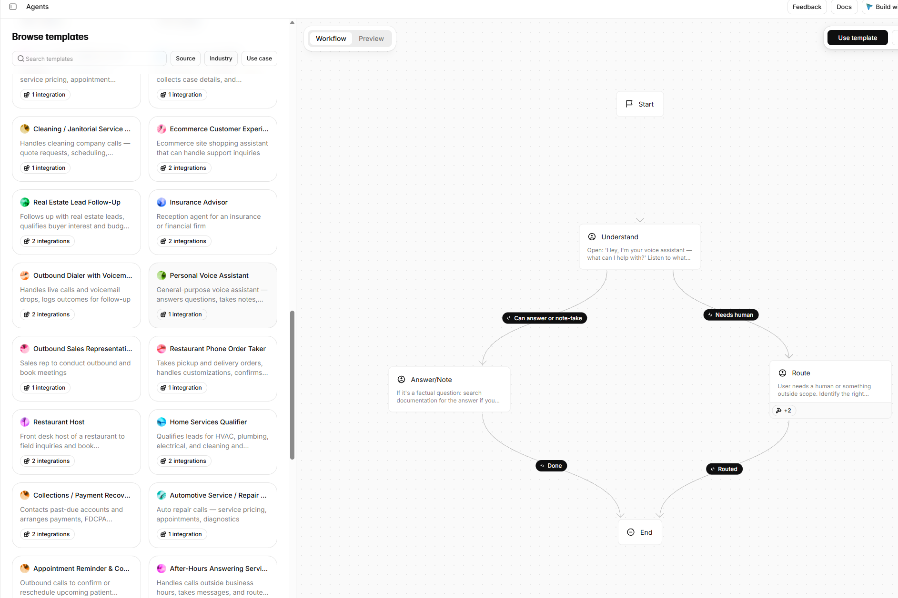

# Stage 04 - Voice assistant

## Goal
Hold a spoken conversation with an ElevenLabs agent from the CoreS3: the device streams
your voice to the agent over a WebSocket and plays the agent's reply through the speaker.

The firmware for this stage is still being built. The account and agent setup below is
ready, and you can do it before the workshop.

## Setup part 1: make an agent
You need an ElevenLabs account (the free tier is enough to start) and one agent in it.

1. Sign in at https://elevenlabs.io and open **Agents** (ElevenAgents) in the sidebar.
2. Choose **Browse templates**, find **Personal Voice Assistant**, and press
   **Use template**. It is a general-purpose assistant that answers questions and takes
   notes.

   

3. The template offers a Zendesk integration. Skip it; we do not use it.
4. Give the agent a name and create it. You can try it in the browser with the
   **Preview** tab to check it talks before going near the device.

Any other template or a blank agent works too. Changing the agent's prompt, voice and
first message later is a good way to make the assistant your own.

## Setup part 2: find your agent id
The agent id starts with `agent_`. The easiest places to find it:

- On the **Agents** list, press the **...** button at the right of your agent's row and
  choose **Copy agent JSON config**. Paste it into a text editor: the id is at the top.
- It is also in the web-page embed code for the agent (the widget snippet).

## Setup part 3: API key
In ElevenLabs, open your profile menu, then **API Keys**, and create a key. Copy it
straight away; it is only shown once.

## Setup part 4: put both in secrets.h
Open `Reference Implementations/secrets.h` (the file you made in stage 02 from
`secrets.h.example`) and fill in:

```c
#define ELEVENLABS_API_KEY  "sk_..."
#define ELEVENLABS_AGENT_ID "agent_..."
```

This file is gitignored. Never commit it, paste it into a chat, or show it on a shared
screen. If you ask Claude Code for help, tell it not to print the file.

## If your free credits run out
Voice conversations use credits quickly. If you run out during the workshop, ask the
presenter: there is a shared workshop agent with its own key. You replace **both** values
in `secrets.h` with the ones you are given, because a key only works with agents in the
same account.

## Done when
For now: your agent answers you in the browser Preview, and `secrets.h` has your key and
agent id. The device part follows.

## Stuck?
See `fallback-prompts/04-voice-assistant.md`.
